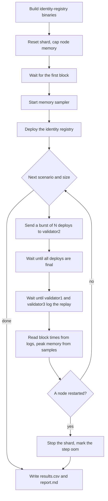

# Identity Registry Benchmarks

This crate has two tools that measure the identity registry on a local
F1R3FLY shard.

| Tool | Question | Entry point |
|---|---|---|
| Block cost sweep | What does one block of N registry deploys cost in time and memory? | `scripts/block-cost.sh`, `make block-cost` |
| Throughput bench | How many registry operations per second can one validator take? | `src/bin/registry_bench.rs`, `make bench` |

Run the block cost sweep first. It shows the block size at which a node runs
out of memory. A throughput run above that load crashes the shard.

All numbers from these tools are **per-node numbers**. All deploys enter
through one validator (validator2). The tools do not measure the effect of
deploys that enter through several validators at the same time.

## Prerequisites

- Docker with Compose v2, and enough free memory for five node containers.
  The block cost sweep caps each node at 4 GiB by default.
- The Rust toolchain of this repository (see the repository `CLAUDE.md`).
- Bash 5 or later. On macOS, install it with `brew install bash`.
- `docker/.env`. The script copies it from `docker/.env.example` if it is
  missing.
- A deployer key with a balance in `docker/genesis/wallets.txt`. If
  `F1R3FLY_SIGNING_KEY` is not set, the script uses `BOOTSTRAP_PRIVATE_KEY`
  from `docker/.env`. That key is funded at genesis.

> **CAUTION:** The block cost sweep deletes all data of the local shard
> (`docker compose -f docker/shard.yml down -v`). It asks before it does
> this. Use `--no-reset` to keep the running shard.

## Block cost sweep

### Quick start

From the `identity-registry` directory:

```bash
./scripts/block-cost.sh
```

The default run does three scenarios (`noop`, `register`, `resolve`) at three
burst sizes (16, 32, 64). It takes approximately 10 to 15 minutes. At the
end, it prints the report and the path of the output directory.

Examples:

```bash
# Only noop and register, larger sizes, no question before the wipe
./scripts/block-cost.sh --yes -s "noop register" -n "16 32 64 128"

# Give each node more memory
./scripts/block-cost.sh -m 8g

# Same as above, through make
make block-cost BLOCK_COST_ARGS="--yes -m 8g"
```

Run `./scripts/block-cost.sh --help` for all options.

### What it does



For each step, the script sends one burst of N deploys with
`registry_bench --count N`. The bench sends all deploys at once, so that the
validator puts them in one block. The bench does not propose. The validator
heartbeat makes the block.

The scenarios are:

| Scenario | Deploy | What it isolates |
|---|---|---|
| `noop` | Sends one value to a reply channel. Does not touch the registry. | Cost of the node itself, the baseline |
| `register` | Registers a new identity | Cost of a write: global register lock, TreeHashMap `contains` and `set` |
| `resolve` | Resolves the current key of an existing identity | Cost of a read: TreeHashMap `get`, no lock |

Before the first `resolve` step, the script registers 16 identities. It does
not measure that prefill.

### How it measures

**Block creation time.** The time comes from the validator2 log. The script
reads three lines for each block:

- `Deploy selection for block #B … selected=K` gives the number of deploys.
- `Propose timing: … total_ms=T` gives the creation time.
- `Block #B (hash...) created and added` gives the block hash.

**Replay time.** The time comes from the validator1 and validator3 logs:
`Block replayed: #B (hash...) (Kd) (Valid) [time]`. The script matches the
block by its hash. Every node that receives a block executes the block again
to validate it. This is the replay.

**Peak memory.** A background sampler reads the cgroup v2 files of each node
container every 0.2 seconds:

- `memory.stat`, field `anon`: anonymous memory, mostly heap. This is the
  number in the report. The kernel cannot free it, so this memory causes
  out-of-memory kills.
- `memory.current`: all memory that the cgroup charges, including page cache
  of the LMDB files. The kernel can free page cache. The sampler records this
  value in `memory.tsv`, but the report does not use it.

The peak of a step is the largest sample between the start of the burst and
the end of the replays. If the sampler cannot read cgroup v2 files (for
example on macOS with Docker Desktop), it uses `docker stats` instead. The
report shows which method was used.

**Out-of-memory detection.** Each node container has a memory cap
(`docker update --memory`). A node that goes above the cap is killed and
restarted by Docker. The script checks the restart count of every node during
each step. If a count changes, the script marks the step `oom`, stops the
shard, and writes the report. If the shard is not stopped, it goes into a
crash loop: on each restart, a node executes the same block again and is
killed again.

### Output

The default output directory is `target/block-cost/<UTC timestamp>/`. Git
ignores `target/`.

| File | Content |
|---|---|
| `report.md` | Run metadata and the result table. Share this file. |
| `results.csv` | One row per step, the same data as the table |
| `memory.tsv` | Every memory sample: `<unix ms> <container> <anon bytes> <current bytes>` |
| `bench-<scenario>-<n>.txt` | The bench summary and errors of each step |
| `ops-<scenario>-<n>.csv` | One row per deploy: block, latencies, phlo cost, outcome |
| `state.txt` | Identities that the run registered |

`results.csv` columns:

| Column | Meaning |
|---|---|
| `scenario`, `deploys` | Step parameters |
| `blocks` | Number of blocks that carried the burst. 1 is the intended case. |
| `max_deploys_per_block` | Largest number of burst deploys in one block |
| `create_ms` | Sum of block creation times on validator2 |
| `replay_ms_validator1`, `replay_ms_validator3` | Sum of replay times |
| `peak_anon_mib_<node>` | Peak anonymous memory of each node in MiB |
| `bench_outcomes` | Outcome counts from the bench, for example `{"ok": 16}` |
| `status` | `ok`, `oom`, `replay_timeout`, or `bench_failed` |

### How to read the results

- Compare `noop` with `register` and `resolve` at the same size. The
  difference is the cost of the registry. The `noop` row is the cost of the
  node.
- Compare the sizes of one scenario. If 2x the deploys gives 2x the time or
  memory, the cost is linear. If it gives 4x, the cost is quadratic.
- `blocks` greater than 1 means that the heartbeat split the burst. The
  per-block numbers are then smaller than for one block of N deploys.
- The creator (validator2) and the replayers (validator1, validator3) can
  have different peaks. Both matter. A shard fails when any validator fails.
- A `oom` row means that the block did not fit in the memory cap. The cap is
  a measurement limit, not a node setting. The node by itself has no limit
  and can use all host memory.

### Limits

- The memory sample interval is 0.2 seconds. A spike that is shorter than
  that can be missed.
- The window of a step can contain other blocks, for example empty heartbeat
  blocks. Their memory use is small compared to a block of user deploys.
- The memory cap stays on the containers after the run. To remove it,
  recreate the containers:
  `docker compose -f docker/shard.yml up -d --force-recreate`.

### Troubleshooting

| Symptom | Cause and action |
|---|---|
| `failed to bind host port … address already in use`, or `could not start every node container` | The shard host ports (40400-40455) are in the Linux ephemeral port range (default 32768-60999). An outgoing connection on the host can hold one of them for a short time. The script retries three times. To prevent it, reserve the ports: `sudo sysctl -w net.ipv4.ip_local_reserved_ports=40400-40455`. |
| `timed out after 600s waiting for the first block` | The genesis ceremony did not complete. Look at `docker compose -f docker/shard.yml logs validator2`. |
| `could not deploy the identity registry` | The registry deploy failed three times. The CLI proposes after the deploy, and the heartbeat can take the deploy first. Run the script again. |
| A step has `submit_error` outcomes | The node refused the deploys. Read `bench-<scenario>-<n>.txt` for the error. |
| A step is `oom` at a small size | Increase the cap with `-m`, or check the host for other large processes. |
| `bash 5 or later is required` | Install a newer bash and run the script with it. |

## Throughput bench

`registry_bench` sends deploys at a fixed rate and follows each deploy by its
deploy ID until the node reports a final state. It does not propose. The
validator heartbeat makes the blocks, as in production.

```bash
export F1R3FLY_SIGNING_KEY=<deployer key>
make deploy                       # prints the registry URI
export IDENTITY_REGISTRY_URI=<uri>

# Register at 2 deploys per second for 60 seconds, with a check at the end
make bench BENCH_ARGS="--scenario register --rate 2 --duration 60 --check"

# Mixed load on the identities from bench-state.txt
make bench BENCH_ARGS="--scenario mixed --rate 2 --duration 60 --mix 10,30,60 --csv mixed.csv"
```

> **CAUTION:** Choose `--rate` from the block cost results. If deploys arrive
> faster than the validator executes them, the pool grows. The next block
> then takes up to 128 deploys (`max-user-deploys-per-block`), which can need
> more memory than the host has. The shard has no memory cap unless you set
> one.

The summary shows:

- outcome counts;
- the number of deploys that were merge-rejected at least once;
- throughput: deploys included during the submit phase, and successful finalized operations per second;
- latency from submit to inclusion, and from submit to finalization, as p50/p95/p99;
- mean phlo per operation type;
- the number of deploys per block.

`--check` resolves every identity that the run changed and compares the key
and the sequence number with the expected values.

Run `cargo run --bin registry_bench -- --help` for all options.
